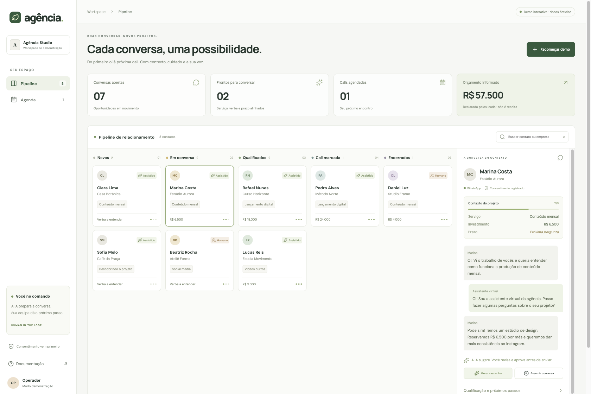

# Agência SDR

**Better first conversations. A human in charge of the next step.**

[](https://github.com/VictorPimentaDev/agencia-whatsapp-sdr/actions/workflows/ci.yml)
[](LICENSE)
[](package.json)
[](https://nextjs.org/)
[](#try-the-demo)

An open-source WhatsApp qualification desk for creative and content agencies. Follow a lead from the first message to a scheduled call, with context, local AI drafts and an explicit handoff to a person.



*Actual app screenshot. Every name, company and phone number in the demo is fictitious. [Mobile view](docs/mobile.png).*

## Try the demo

```sh
git clone https://github.com/VictorPimentaDev/agencia-whatsapp-sdr.git
cd agencia-whatsapp-sdr
npm ci && npm run dev
```

Open **http://127.0.0.1:3000**. Node 22+ is required. No API key, Docker, database or model download is needed for this mode.

Select Marina, generate a draft, take over the conversation, fill the missing project timeline and book a call. Changes live only in your browser's current session; refresh or **Recomeçar demo** resets them. **Simular envio** never contacts WhatsApp. The demo refreshes its simulated service window for each action; live mode uses the persisted inbound timestamp.

## What you can do

| Workflow | Included |
|---|---|
| Lead qualification | Service, budget and timeline; operator-confirmed stage changes |
| Conversation desk | Five-stage kanban, contact search, conversation history and keyboard-accessible controls |
| AI assistance | Offline question rules or real local Ollama drafts; review before sending |
| Human handoff | Pause/resume drafts, explicit opt-out, consent evidence |
| Calls | Record a future appointment in the CRM and browse the agenda |
| WhatsApp | Signed Meta Cloud API ingress; Evolution/Baileys gateway adapter |
| MCP | Local stdio tools to list leads and update CRM state using the operator's token |
| Persistence | Supabase Auth, PostgreSQL RLS, duplicate-event protection and revision guards |

Calls are CRM records, not external calendar invitations. This release does not autonomously extract qualification fields or send messages. The operator confirms fields and approves each reply. That boundary is deliberate and is enforced by the MCP tool schemas too.

## Connect Supabase locally

Install the [Supabase CLI](https://supabase.com/docs/guides/local-development/cli/getting-started) and start Docker, then:

```sh
supabase start
cp .env.example .env.local
```

Copy the local API URL, anon key and service-role key from `supabase status` into `.env.local`. Keep the service-role key on the server. The initial migration and seed run on first start; for an existing **local** project you can apply them with `supabase db reset` (this erases that local project's data). Restart `npm run dev`.

Choose **Conectar CRM** and use the local-only fixture account:

- Email: `operator@example.test`
- Password: `local-demo-only`
- Webhook owner: `00000000-0000-4000-8000-000000000100`

The seed number is deliberately non-routable and blocked from sending. It is for UI/database checks. Never deploy the seed account or its known password. For real use, create your own Supabase user and set `WORKSPACE_OWNER_ID` to that user's ID. One authenticated user owns each workspace; shared-team membership is outside this starter.

## Connect WhatsApp and a model

[Adapter setup →](docs/adapters.md) explains Meta callback verification, Evolution's authenticated gateway contract, Ollama JSON drafts and MCP client configuration.

A real inbound message is stored, not automatically answered. Record consent, confirm the qualification fields, generate/review a draft and select **Aprovar e enviar**. Sends require an inbound text message within the last 24 hours. No approved-template messaging or bulk campaigns are implemented.

`DRAFT_PROVIDER=rules` works offline. `DRAFT_PROVIDER=ollama` calls your local model; a failed model request remains an error, not an invented success. Model text cannot change CRM state or send messages by itself.

```text
WhatsApp webhook ── signature / gateway secret ── atomic ingress + dedupe
                                                        │
                                                   Supabase / RLS
                                                        │
                  MCP user JWT ── authenticated CRM API ── operator desk
                                          │                    │
                                   draft only             approve send
                                          │                    │
                                        Ollama          WhatsApp adapter
```

## Failure behavior matters

Stale updates fail instead of overwriting another conversation change. Sending first reserves an outbound record, then calls the provider. A timeout becomes **uncertain**, so a retry cannot silently send the same message twice. Check the provider and record the result before trying again. A successful request means provider acceptance, not handset delivery.

Erasing a contact removes its conversation. Content-free, unlinked event IDs remain to reject old webhook retries. The history window retains 200 entries, including unresolved sends; this is not a permanent audit archive. See [privacy and LGPD notes](docs/privacy.md) for retention, consent evidence and data-subject requests.

## Run the checks

```sh
npm run lint
npm run typecheck
npm test
npm run test:db
npx playwright install chromium
npm run test:e2e
npm run build
```

Unit/contract tests exercise qualification, consent, window boundaries, HMAC, webhook normalization, provider adapters, Ollama payload minimization and a real MCP stdio handshake. PostgreSQL tests execute the migration and seed, then verify RLS isolation, deduplication, opt-out, delivery updates and erasure/replay behavior. Browser tests cover the operator flow on desktop and mobile.

`test:db` requires PostgreSQL tools or `PG_TEST_URL` pointing to a fresh, disposable database. It creates and removes its own isolated local cluster by default. It does not connect to your existing Supabase database. CI runs application checks plus a PostgreSQL 17 service with the same SQL assertions.

[Verification and known limits →](docs/verification.md) · [Contributing →](CONTRIBUTING.md)

## Em português

Um SDR assistido para agências de conteúdo: qualificação no WhatsApp, kanban, rascunhos com IA local, agenda no CRM e passagem clara para atendimento humano. O demo funciona sem credenciais e usa apenas dados fictícios. A IA prepara; o operador revisa e decide. Consentimento e opt-out fazem parte do fluxo, não de uma promessa de conformidade automática.

Código original por Victor Pimenta. MIT. Não afiliado à Meta, Evolution, Supabase ou Ollama. Não use como disparador de mensagens em massa.
